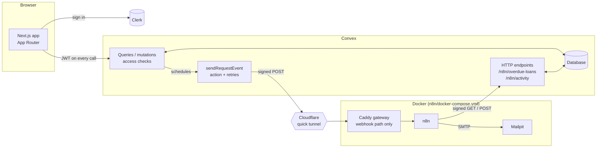

# LendLoop

A neighbourhood tool-lending board with automated workflows. Neighbours list tools,
request them for a date range, approve or decline requests and mark loans as
returned. n8n sends the notification emails and the daily overdue reminders, and
writes what it did back to Convex.

Built for the Fluence International Full-Stack Developer take-home.

**Stack:** Next.js 16 (App Router) · TypeScript · Clerk · Convex · n8n 2.45 (Docker) · Tailwind CSS

---

## Contents

1. [What's implemented](#whats-implemented)
2. [Architecture](#architecture)
3. [Local setup](#local-setup)
4. [Environment variables](#environment-variables)
5. [Access control](#access-control)
6. [Integration design (Convex ↔ n8n)](#integration-design-convex--n8n)
7. [Security and data-minimisation decisions](#security-and-data-minimisation-decisions)
8. [Tests](#tests)
9. [What I would change for production](#what-i-would-change-for-production)
10. [Known limitations](#known-limitations)

---

## What's implemented

| Requirement | Where |
|---|---|
| Public page: tagline, tool list with **name and category only**, sign-in button | `app/page.tsx`, `convex/tools.ts` → `listPublic` |
| List tools (name, category, condition, description) | `app/(signed-in)/listings` |
| Request a tool for a date range | `app/(signed-in)/tools` → `requests.create` |
| Approve / decline requests on your own tools, mark loans returned | `app/(signed-in)/incoming` |
| All tools with availability, filterable by category (plus search by name) | `app/(signed-in)/tools` |
| My listings · My requests · Incoming requests | `app/(signed-in)/…` |
| Admin: remove any listing, view all loans, mark a Trusted Lender | `app/(signed-in)/admin`, `convex/admin.ts`, `tools.remove` |
| Access control enforced **in Convex functions** | `convex/lib/auth.ts` + every function |
| n8n workflow 1: request notification from a Convex webhook | `n8n/workflows/request-notification.json` |
| n8n workflow 2: daily overdue reminders with write-back | `n8n/workflows/daily-overdue-reminders.json` |
| HMAC-signed payloads, verified on receipt, both directions | `convex/lib/hmac.ts`, "Verify signature" node |
| Secrets out of code and out of exported workflows | `n8n/.env` (git-ignored), Convex env vars |
| Idempotent write-backs | `automation.recordEvent` (`idempotencyKey`) |
| Retries + error workflow, failures visible | Convex backoff, n8n node retries, `n8n/workflows/error-handler.json`, admin page |
| **Bonus:** recent automation activity on each loan | `requests.describe` → "Overdue reminder emailed, 2 days ago" |
| Light and dark mode (follows the system, with a toggle) | `app/globals.css` tokens, `next-themes` |

## Architecture



- **Next.js** renders the pages. All data comes from Convex over a WebSocket, so
  pages stay statically prerendered and update live.
- **Clerk** signs users in. Convex verifies Clerk's JWT itself (`convex/auth.config.ts`)
  and every function derives the caller from it.
- **Convex** holds the data and all business rules. When a request is created or
  changes status, the mutation schedules an action that posts a signed event to n8n.
- **n8n** runs in Docker with **Mailpit** (catches every email locally, nothing is sent
  to real inboxes). A **Caddy** gateway exposes only the LendLoop webhook path to the
  tunnel; the n8n editor and API are never public.
- The **Cloudflare quick tunnel** exists only because Convex runs in the cloud and n8n
  runs on a laptop. It is opt-in (`--profile tunnel`).

### Project layout

```
app/                    pages (public "/" + app/(signed-in)/* behind sign-in)
components/             UI pieces (header, loan list, badges)
convex/
  schema.ts             users, tools, requests, automationEvents
  lib/auth.ts           requireUser / requireAdmin (the access-control core)
  lib/hmac.ts           signing + verification shared by all n8n calls
  lib/requests.ts       the one place a request's status changes (+ n8n event)
  users.ts tools.ts requests.ts admin.ts
  automation.ts         webhook sender, overdue query, idempotent write-back
  http.ts               signed endpoints for n8n
  devTools.ts           internal helper to test reminders
  *.test.ts             convex-test suites
n8n/
  docker-compose.yml    n8n + Mailpit + gateway + (opt-in) tunnel
  Caddyfile             only /webhook/lendloop-request is reachable from outside
  workflows/*.json      exported workflows
  credentials/          Mailpit SMTP credential (local, contains no secret)
```

## Local setup

### Prerequisites

- Node.js 20.9+ (developed on Node 24) and npm
- Docker Desktop (for n8n)
- A Clerk account and a Convex account (both have free tiers)

### 1. App, Clerk and Convex

```bash
git clone <this repo> && cd lendloop
npm install
cp .env.example .env.local
```

1. **Clerk:** create an application, then copy the publishable and secret keys into
   `.env.local`.
2. In Clerk → **Configure → Integrations**, activate **Convex** and note the
   **Frontend API URL** (`https://<name>.clerk.accounts.dev`).
3. In Clerk → **Configure → Sessions → Customize session token**, add the claims the
   app uses for display names and reminder emails:
   ```json
   { "name": "{{user.full_name}}", "email": "{{user.primary_email_address}}" }
   ```
4. **Convex:** run `npx convex dev` and create a project. It writes `CONVEX_DEPLOYMENT`,
   `NEXT_PUBLIC_CONVEX_URL` and `NEXT_PUBLIC_CONVEX_SITE_URL` to `.env.local`. Leave it
   running.
5. In a second terminal, tell Convex which Clerk instance to trust:
   ```bash
   npx convex env set CLERK_FRONTEND_API_URL https://<name>.clerk.accounts.dev
   ```
6. Start the app with `npm run dev` and open http://localhost:3000. Sign in once.
7. Make your account an admin. The function is internal, so only the deployment owner
   can run it:
   ```bash
   npx convex run users:promoteToAdmin '{"email":"you@example.com"}'
   ```

At this point the app works fully; notifications are skipped (and logged) until n8n
is configured.

### 2. n8n (Docker)

```bash
cd n8n
cp .env.example .env
```

Fill `n8n/.env`:

- `N8N_ENCRYPTION_KEY` and `LENDLOOP_HMAC_SECRET`: two different random values,
  e.g. `node -e "console.log(require('crypto').randomBytes(32).toString('hex'))"`
- `LENDLOOP_CONVEX_SITE_URL`: the `NEXT_PUBLIC_CONVEX_SITE_URL` value from `.env.local`

Give Convex the same HMAC secret:

```bash
npx convex env set LENDLOOP_HMAC_SECRET <same value as in n8n/.env>
```

Start n8n, Mailpit and the gateway, then import the credential and workflows:

```bash
docker compose up -d
docker compose exec n8n n8n import:credentials --input=/credentials/mailpit-smtp.json
docker compose exec n8n n8n import:workflow --separate --input=/workflows
docker compose exec n8n n8n publish:workflow --id=LLrequestNotify1
docker compose exec n8n n8n publish:workflow --id=LLoverdueRemind1
docker compose exec n8n n8n publish:workflow --id=LLerrorHandler01
docker compose restart n8n
```

Open http://localhost:5678 and create the n8n owner account. The Mailpit inbox is at
http://localhost:8025.

### 3. Connect Convex to n8n

Convex runs in the cloud, so it needs a public URL for the webhook. Start the tunnel
(it opens a public URL, which is why it is opt-in) and read its address:

```bash
docker compose --profile tunnel up -d
docker compose logs tunnel | grep trycloudflare.com
npx convex env set N8N_WEBHOOK_URL https://<random>.trycloudflare.com/webhook/lendloop-request
```

Only that path is reachable through the tunnel; everything else returns 404.

### 4. Try it

1. With two accounts (e.g. a second browser profile), list a tool with one and
   request it with the other. Mailpit receives "New request for your …".
2. Approve it. The borrower gets "Approved: …", and the loan shows
   "Lender notified by email · just now".
3. To test reminders, push the approved loan into the past, then open the
   **LendLoop – Daily overdue reminders** workflow and click **Execute workflow**:
   ```bash
   npx convex run devTools:makeLoanOverdue '{"requestId":"<loan id>"}'
   ```
   Run it a second time: no second email is sent (see [idempotency](#idempotency)).

To stop everything: `docker compose --profile tunnel down` (data is kept in the
`n8n_data` volume).

## Environment variables

| Variable | Where it lives | Purpose |
|---|---|---|
| `NEXT_PUBLIC_CLERK_PUBLISHABLE_KEY`, `CLERK_SECRET_KEY` | `.env.local` | Clerk |
| `CONVEX_DEPLOYMENT`, `NEXT_PUBLIC_CONVEX_URL`, `NEXT_PUBLIC_CONVEX_SITE_URL` | `.env.local` (written by `npx convex dev`) | Convex |
| `CLERK_FRONTEND_API_URL` | Convex deployment | Which Clerk issuer Convex trusts |
| `LENDLOOP_HMAC_SECRET` | Convex deployment **and** `n8n/.env` | Signs/verifies every Convex ↔ n8n call |
| `N8N_WEBHOOK_URL` | Convex deployment | Where request events are posted (optional) |
| `N8N_ENCRYPTION_KEY` | `n8n/.env` | Encrypts credentials stored by n8n |
| `LENDLOOP_CONVEX_SITE_URL` | `n8n/.env` | Base URL of the Convex HTTP endpoints |
| `LENDLOOP_ADMIN_EMAIL` | `n8n/.env` | Recipient of workflow-failure alerts |

`.env.local` and `n8n/.env` are git-ignored; only the `.example` files are committed.
The Convex-side variables are declared (as optional) in `convex/convex.config.ts`.

## Access control

Every rule is enforced inside the Convex function, so the UI hiding a button is a
convenience, not the protection. The caller is always derived from the verified JWT
(`ctx.auth`); no function accepts a user id to decide who the caller is.

| Action | Who may do it | Function |
|---|---|---|
| See tool names + categories | Anyone, signed out included | `tools.listPublic` |
| See tool details, owner name, availability | Signed-in users | `tools.list` |
| Create a listing | Signed-in users (owner = caller) | `tools.create` |
| Edit a listing | Its owner only (not admins) | `tools.update` |
| Delete / remove a listing | Its owner, or an admin | `tools.remove` |
| Request a tool | Signed-in users, not for their own tool | `requests.create` |
| Approve / decline / mark returned | The tool's lender only | `requests.approve` / `decline` / `markReturned` |
| Cancel a pending request | Its borrower only | `requests.cancel` |
| See requests | Only those you borrow or lend | `requests.mine` / `incoming` |
| All loans, members, Trusted Lender, automation problems | Admins only | `admin.*` |
| Become admin | Deployment owner via CLI only | `users.promoteToAdmin` (internal) |

New users are always created as plain users; `users.ensure` never sets or changes a
role. Removing a tool is a soft delete so loan history stays readable, and a tool on
loan can't be removed until it's returned.

## Integration design (Convex ↔ n8n)

### Workflow 1 — request notification

1. A mutation creates a request or changes its status through `changeStatus`
   (`convex/lib/requests.ts`), the single place where status changes. It schedules
   `automation.sendRequestEvent`. Because it is scheduled inside the mutation, the
   event is sent only if the change was actually saved.
2. The action builds a minimal payload (one recipient, the tool name, the dates),
   signs it and posts it to n8n.
3. n8n verifies the signature on the raw body. An invalid or stale signature gets
   **401** and nothing else runs. A valid one gets **200** straight away, so Convex
   isn't held while the email is sent.
4. n8n writes the email from a template, sends it, then posts a signed write-back to
   `POST /n8n/activity` with `idempotencyKey = notify:<requestId>:<status>`.

| Status | Who is emailed |
|---|---|
| pending (new request), cancelled | the lender |
| approved, declined, returned | the borrower |

### Workflow 2 — daily overdue reminders

1. Runs every day at 09:00 (Africa/Casablanca), or on demand via **Run now**.
2. Calls the signed `GET /n8n/overdue-loans`. Convex returns approved loans whose end
   date has passed **and that haven't had a reminder recorded today**.
3. Splits the list, emails each borrower, and posts a signed write-back with the
   `idempotencyKey` Convex supplied: `reminder:<requestId>:<date>`.

### Workflow 3 — error handler

Set as the error workflow of 1 and 2. On any failure it emails `LENDLOOP_ADMIN_EMAIL`
and records a `workflow_error` event in Convex, shown on the admin page under
**Automation problems**.

### Signing

Both directions use the same scheme (`convex/lib/hmac.ts`, mirrored in the n8n Code
nodes):

```
X-LendLoop-Timestamp: <unix seconds>
X-LendLoop-Signature: sha256=HMAC_SHA256(secret, "<timestamp>.<raw body>")
```

The receiver recomputes the HMAC over the exact bytes it received (the n8n webhook
keeps the raw body for this), compares in constant time, and rejects timestamps more
than 5 minutes old to block replays. GET requests sign an empty body.

### Idempotency

Every write-back carries an `idempotencyKey` that names the real-world event.
`automation.recordEvent` inserts it only if that key doesn't exist yet and answers
`recorded` or `duplicate`, so n8n can retry a write-back safely. For reminders the key
includes the date, and the overdue query skips loans already reminded that day, so
re-running the workflow (manually or after a crash) doesn't email anyone twice.

### Retries and failure visibility

| Where | Behaviour |
|---|---|
| Convex → n8n webhook | 5 attempts with backoff (30 s, 2 min, 10 min, 30 min). After the last one a `notification_failed` event appears on the admin page. |
| n8n email and HTTP nodes | 3 tries, 3 s apart, then the error workflow runs. |
| Error workflow | Emails the admin and records a `workflow_error` in Convex. |
| Bad write-back (unknown request, wrong kind) | Convex answers 400, which fails the node and so reaches the error workflow. |

## Security and data-minimisation decisions

- **Authorisation lives in Convex.** Pages only decide what to show; the
  `(signed-in)` layout and hidden admin links are UX.
- **No identity from arguments.** The caller always comes from the verified JWT;
  ownership is checked against stored ids.
- **The public page returns only name and category.** No owner, condition or
  description reaches anonymous visitors.
- **Emails are never shown to other users.** Not to borrowers, lenders, or even the
  admin list. They're stored only so reminders can be sent.
- **Payloads to n8n carry only what the email needs:** one recipient's name and email,
  the other party's display name, the tool name, dates and an opaque request id.
  The overdue endpoint returns only the borrower's contact, never the lender's.
- **Failure details are admin-only.** Users see "Overdue reminder emailed", never
  stack traces or provider errors.
- **n8n endpoints are internal functions behind signatures.** The browser can't call
  `automation.*`; n8n can reach only the two signed HTTP routes.
- **Secrets stay out of the repo and out of workflow JSON.** Workflows read
  `$env.LENDLOOP_HMAC_SECRET`; the exported files contain no secret and no
  instance/owner data (I stripped the owner's project name from the export).
- **Least exposure for the local stack.** n8n and Mailpit bind to `127.0.0.1`; the
  tunnel only reaches a gateway that serves one path; the tunnel itself is opt-in.
- **Input validation.** Convex validators on every function, length limits on text,
  real-calendar date checks, max 30-day loans, overlap checks, and typed checks on
  every field of the HTTP write-back body.

## Tests

```bash
npm test
```

19 tests with `convex-test` (`convex/*.test.ts`):

- **Access control:** anonymous visitors can't write; another user can't edit or
  delete a listing; an admin can remove but not edit; only the lender can
  approve/decline/return; a third user can't see or act on someone else's request;
  you can't borrow your own tool; roles don't change on sign-in.
- **Business rules:** full loan lifecycle, overlapping dates, invalid/past dates.
- **Integration:** signatures accepted only for the exact body, right secret and a
  fresh timestamp; endpoints return 401 unsigned; overdue loans leak no lender email;
  write-backs are idempotent and stop a second reminder the same day; malformed
  write-backs get 400; users see sent reminders but not failures.

The n8n workflows were tested by hand end to end (forged request → 401; real
request → email + write-back; failing write-back → admin alert + admin-page entry;
re-running reminders → no duplicate).

## What I would change for production

**Hosting and environments**

- Separate Clerk **production** instance and Convex **production** deployment, each
  with its own secrets; deploy the app (e.g. Vercel) with `npx convex deploy` in CI.
- Run n8n on n8n Cloud or a proper server (Postgres instead of SQLite, queue mode with
  workers, backups) behind a stable domain with TLS, instead of a laptop and a quick
  tunnel whose URL changes on every restart.

**Integration security**

- One secret per direction (Convex → n8n and n8n → Convex), with a key id in the
  header so secrets can be rotated without downtime.
- Store the secret in n8n's credential store or an external secrets manager rather
  than an environment variable readable by every workflow
  (`N8N_BLOCK_ENV_ACCESS_IN_NODE=false` is a local-only convenience).
- Keep a short-lived record of seen signatures to close the 5-minute replay window
  completely.

**Email**

- A real provider (Postmark, SES, Resend…) with SPF/DKIM/DMARC, bounce handling and
  an unsubscribe/notification-preferences setting per user.
- Record the provider's message id in the write-back and claim the event *before*
  sending, so a crash between "sent" and "recorded" can't produce a duplicate.

**Data and privacy** (more important for a healthcare-adjacent organisation)

- A data-processing review of every processor (Clerk, Convex, n8n host, email
  provider), data-residency choices, retention rules for `automationEvents`, and a
  way for users to export or delete their data.
- Audit log of admin actions (removals, Trusted Lender changes, role changes).
- Rate limiting on mutations (`@convex-dev/rate-limiter`) and abuse controls on
  requests.

**Product and robustness**

- Store a timezone per user instead of computing "today" in UTC.
- Treat a loan as "on loan" only between its start and end date (today an approved
  future loan already shows the tool as unavailable).
- Search runs in the browser over the (at most 200) tools already loaded. With a
  larger board it would move to a Convex search index with pagination.
- Pagination for long lists, monitoring and alerting on the error workflow (not just
  an email), and CI running `tsc`, `eslint`, `npm test` and `next build` on every PR.

## Known limitations

- Dates are calendar days compared in UTC.
- "On loan" is shown as soon as a request is approved, even if it starts later.
- The quick-tunnel URL changes when the tunnel restarts; update `N8N_WEBHOOK_URL`.
- Delivery is at-least-once: if n8n accepts an event but its 200 response is lost,
  Convex retries and the email can go out twice. Write-backs stay single either way,
  because of the idempotency key (see the production note above).
- `devTools.makeLoanOverdue` exists only to demo reminders; it is internal and
  should be removed from a production build.

---

Built with AI pair-programming (Claude Code). I reviewed every change and can walk
through any part of the code and the design decisions. The visual pass followed the
[unslop](https://github.com/heydamir/unslop) skill by Damir Sokolovsky (CC BY 4.0) and
Anthropic's [frontend-design](https://github.com/anthropics/skills) skill.
